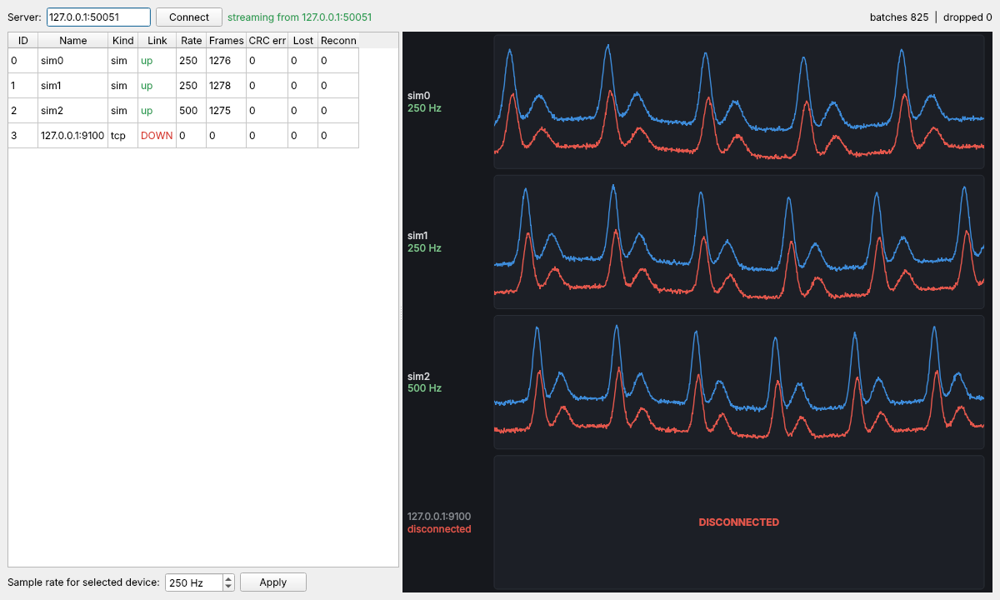
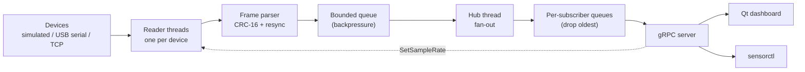

# sensord

[](https://github.com/abhiroopyalavarthi/sensord/actions/workflows/ci.yml)

A C++20 service that reads live data from sensor devices over USB serial and
TCP, streams it to clients over gRPC, and plots it in a Qt 6 dashboard. Every
test runs under AddressSanitizer, UndefinedBehaviorSanitizer and
ThreadSanitizer in CI, and the frame parser is fuzzed with libFuzzer.



https://github.com/user-attachments/assets/9d4e98e0-4c98-49a2-9b19-9ac110b4d147

*Three simulated PPG devices (one switched to 500 Hz from the dashboard) and a
TCP device that has been unplugged.*



## What it does

- **`sensord`**: the service. One reader thread per device, a bounded queue, a hub
  thread that fans batches out to every subscriber, and a gRPC server.
- **`sensord-dashboard`**: Qt 6 app. Live strip charts per device, device table
  with link status / CRC errors / lost frames / reconnects, sample-rate control.
- **`sensorctl`**: CLI client: `list`, `subscribe`, `set-rate`, and `check`
  (end-to-end sequence check).
- **`sensord-sim`**: a fake sensor board that serves the real wire protocol over
  TCP or a pseudo-terminal, so everything runs with no hardware. Kill it to
  "unplug" the device; start it again to plug it back in.
- **`firmware/esp32_sensord`**: ESP32 sketch that streams real ADC readings in the
  same format over USB and obeys set-rate commands *(stretch goal; not yet
  tested on a board)*.

## Quick start (macOS)

```bash
# one-time setup
xcode-select --install                     # Apple clang (Xcode 16.3+ / CLT for jthread)
/bin/bash -c "$(curl -fsSL https://raw.githubusercontent.com/Homebrew/install/HEAD/install.sh)"
brew install cmake ninja grpc protobuf qt googletest

# build + test
cmake -S . -B build -G Ninja -DCMAKE_PREFIX_PATH="$(brew --prefix qt);$(brew --prefix)"
cmake --build build
ctest --test-dir build --output-on-failure

# run: 4 simulated devices + one "real" TCP device
./build/sensord-sim --tcp 9000 &
./build/sensord --sim 4 --sim-garbage 0.01 --tcp 127.0.0.1:9000
./build/dashboard/sensord-dashboard          # in another terminal
```

Linux (Ubuntu 24.04):
`sudo apt install cmake ninja-build clang libgrpc++-dev protobuf-compiler-grpc libprotobuf-dev protobuf-compiler libgtest-dev qt6-base-dev`,
then the same `cmake` commands without the prefix path.

### Things to try

```bash
./build/sensorctl list                        # devices, link state, CRC errors, reconnects
./build/sensorctl subscribe --seconds 5       # live samples/s per device
./build/sensorctl set-rate 0 1000             # command reaches the device over its link
./build/sensorctl check --seconds 10          # no gaps except reported drops -> "check OK"
kill %1                                       # unplug the TCP device: dashboard shows DISCONNECTED
./build/sensord-sim --tcp 9000 &              # plug it back in: reconnects on its own
```

Serial with no hardware: `./build/sensord-sim --pty` prints a path like
`/dev/ttys004`; run `./build/sensord --serial /dev/ttys004`. With the ESP32:
`./build/sensord --serial /dev/cu.usbserial-0001@921600`.

## Wire protocol

| Field | Size | Purpose |
|---|---|---|
| Sync `0xA5 0x5A` | 2 B | Start of frame |
| Length | 2 B | Payload size (max 1024) |
| Sequence | 4 B | Detects dropped frames |
| Payload | N B | Message (below) |
| CRC-16/CCITT-FALSE | 2 B | Over length + sequence + payload |

Messages: `Samples` (channel, t0 µs, period µs, float32 values),
`SetRate` (host → device), `RateAck` (device → host). When a CRC fails the
parser slides forward one byte and hunts for the next sync pair, so one bad
byte costs at most one frame. Gaps in sequence numbers are counted as lost
frames and reported to clients.

gRPC API ([proto/telemetry.proto](proto/telemetry.proto)):

```proto
service Telemetry {
  rpc ListDevices(ListDevicesRequest) returns (ListDevicesResponse);
  rpc Subscribe(SubscribeRequest) returns (stream SampleBatch);
  rpc SetSampleRate(SetSampleRateRequest) returns (SetSampleRateResponse);
}
```

## Design decisions

- **One device interface, three implementations.** Simulator, USB serial
  (POSIX termios, raw mode) and TCP all implement `open / read / write / close`.
  The reader thread never knows which one it has.
- **Backpressure on the way in, drop-oldest on the way out.** Readers push into
  one bounded queue and block if the hub falls behind, so memory can't grow
  without bound. Each subscriber has its own bounded queue; when it fills, the
  *oldest* batch is dropped and counted, and the count is sent to that client.
  A slow client never stalls the devices or the other clients (tested).
- **Batching.** Samples are grouped per device into 10 ms batches. Batches are
  `shared_ptr<const Batch>`, so fan-out to N subscribers copies a pointer, not
  the samples.
- **Reconnect with exponential backoff** (100 ms doubling to 5 s). A set-rate
  command is remembered and re-sent after every reconnect.
- **Clean shutdown.** Every thread is a `std::jthread`; every blocking wait
  (`condition_variable_any::wait(lock, stop_token, ...)`) wakes on stop. Order:
  stop gRPC → stop readers → close the input queue → stop the hub, which closes
  all subscriptions so blocked handlers return. `SIGINT` is handled with
  `sigwait` on the main thread, not an async handler.
- **Qt's one rule.** gRPC calls run on worker threads in `RpcClient`; data
  reaches widgets only through queued Qt signals. The stream thread coalesces
  updates to ~30/s so high sample rates can't flood the GUI event loop.

## How it's checked

| Check | Where |
|---|---|
| 60 GoogleTest tests: CRC, framing (split at every byte, back-to-back, bad CRC, bad length, garbage with fake syncs), messages, queue (full, empty, close/stop while blocked), devices (pty serial, TCP, unplug), pipeline, gRPC end-to-end | `tests/` |
| ASan + UBSan on every push (all tests) | CI |
| TSan on every push (all tests except gRPC E2E, see [bug log #2](docs/bug-log.md#2-threadsanitizer-and-grpc)) | CI |
| Stress test: 8 devices with garbage, corruption and random unplugs; 20 subscribers joining and leaving at random; set-rate and list calls; shutdown under load. 3 seeds in ctest, 5 more in CI | `tests/test_stress.cpp` |
| libFuzzer on the frame parser + message decoder: 1 hour locally (26.7M inputs, 0 crashes), 3 min per CI run; saved inputs replayed as a regression test | `fuzz/` |
| Real-process smoke test: sim + server + `sensorctl check` + SIGINT must exit 0 | CI |
| Planted out-of-bounds read in the parser is caught by ASan | done once, see below |

Milestone-0 sanity check: changing the sync search to `while (sync < n && ...)`
(reads `buf_[n]`) makes ASan fail `Frame.SplitOneByteAtATime` with
`heap-buffer-overflow ... frame.cpp:44`.

## Results

Measured with `sensord-bench`, which runs everything in one process: N
simulated devices → pipeline → gRPC server on 127.0.0.1 → M gRPC clients,
each on its own connection. **Latency** is from the moment a sample was taken
on the (simulated) device to the moment a client decoded it, on the same
monotonic clock. The simulators run in the same process, so their CPU is
included.

**MacBook Pro (M2)**, Apple clang, `-O2`, 10 s runs, 10 ms batching:

| Load | In | Out (all clients) | Drops | p50 | p99 | p99.9 | CPU |
|---|---|---|---|---|---|---|---|
| 16 devices × 1 kHz × 2 ch, 4 clients | 32.0K samples/s | 128K samples/s | 0 | 10.4 ms | 14.9 ms | 31.2 ms | 41% of a core |
| 192 devices × 20 kHz × 2 ch, 8 clients | 7.68M samples/s | 61.4M samples/s | 0 | 10.4 ms | 19.9 ms | 60.1 ms | 477% of a core |

p50 sits at ~10 ms because that's the batch flush window (see below).

The tables below are from a 2-vCPU Linux cloud VM (Intel Xeon @ 2.1 GHz,
GCC 13), where the batching comparison and the CRC before/after were run.

**Typical load** (16 devices × 1 kHz × 2 channels, 4 subscribers, 10 s, 3 runs):

| | gRPC msgs/s | p50 latency | p99 latency | CPU |
|---|---|---|---|---|
| Batching (10 ms) | 3,157 | 10.2 ms | 11.9 ms | 21–24% of a core |
| One message per frame | 12,630 | 0.84 ms | 2.2 ms | 38–45% of a core |

Batching sends 4× fewer messages for about half the CPU and costs ~9 ms of
latency, which is the flush window. `--flush-ms` picks the trade-off.

**Heavy load** (64 devices × 20 kHz × 2 channels = 2.56M samples/s in, 16
subscribers = 41M samples/s out): 0 drops, p50 10.3 ms, p99 15.7 ms, 158% CPU.

**Saturation** (192 devices × 20 kHz × 2 ch = 7.68M samples/s in, 8
subscribers), before and after the CRC change below, 2 runs each:

| | delivered | dropped batches | p50 | p99 |
|---|---|---|---|---|
| Bitwise CRC | 54.0–59.6M samples/s | 22,006–56,241 | 109–154 ms | 291–305 ms |
| Table CRC | 61.4–61.5M samples/s | 0–301 | 12.0–12.1 ms | 77–125 ms |

At 256 devices (10.2M samples/s in) both versions saturate; the table
version still delivers 70–72M samples/s vs 50–55M (+35%).

## Profiling

`perf record -e cpu-clock -g` on `sensord-bench` at the saturation point
(run in Linux; perf isn't available on macOS):

```
before                                            after
35.72%  sensord::protocol::crc16                  13.23%  sensord::protocol::crc16
 9.64%  SignalGenerator::sample_value              9.46%  SignalGenerator::sample_value
 4.00%  __ieee754_exp_fma                          4.73%  [k] finish_task_switch
 3.96%  __sin_fma                                  3.95%  __ieee754_exp_fma
 3.61%  __memmove_avx512_unaligned_erms            3.78%  [k] _raw_spin_unlock_irqrestore
```

Every frame is CRC'd twice (device side when the simulator encodes it, host
side when the decoder checks it), and the first version processed one bit at a
time: 8 shift/xor/branch steps per byte. The fix is the standard 256-entry
lookup table, built at compile time by a `constexpr` function, so it's one
table lookup per byte. `sensord-crc-bench` measures 122 MB/s → 348 MB/s (2.8×)
on frame-sized buffers. A unit test checks the table version against the
bitwise one on 2,000 inputs.

What's left at the top is still CRC plus the simulator's own signal math
(`sample_value`, `exp`, `sin`, ~17% together), which wouldn't exist with
real devices. Next candidates: a slicing-by-8 CRC, or caching one period of
the simulated waveform.

```bash
perf record -e cpu-clock -F 999 -g -- ./build/sensord-bench --devices 192 --rate 20000 --subscribers 8
perf report --no-children --sort symbol
```

## Bugs found

The full write-ups are in [docs/bug-log.md](docs/bug-log.md).

1. **One unplug counted as two reconnects.** Spotted in `sensorctl list`;
   GDB `dprintf` on the reconnect path didn't reproduce it in a Debug build, so
   it was timing-dependent; counting over 20 unplugs gave 23 drops; `strace`
   showed the simulator closing its client socket 244 µs before its listen
   socket, and sensord reconnecting into that gap. Fixed: 20/20.
2. **TSan + gRPC.** 396 TSan reports in the gRPC tests, 0 starting in this
   code; all inside the non-instrumented system gRPC. Scoped the TSan job.
3. **CRC-16 was the top hotspot** (perf, 18% of samples). Table-driven CRC.
4. **Dashboard didn't mark a device DISCONNECTED** if it had no data yet.

## Layout

```
proto/       telemetry.proto
src/
  devices/   simulator, USB serial (termios), TCP
  protocol/  frame encoder/decoder, CRC-16, messages
  pipeline/  bounded queue, device readers, hub, core
  server/    gRPC service
apps/        sensord, sensord-sim
dashboard/   Qt 6 app
cli/         sensorctl
tests/       unit, stress, end-to-end
fuzz/        libFuzzer target + saved inputs
bench/       load generator, CRC micro-benchmark
firmware/    ESP32 sketch
docs/        bug log, screenshot
```

## Fuzzing locally

```bash
# Linux
cmake -S . -B build-fuzz -G Ninja -DCMAKE_CXX_COMPILER=clang++ -DSENSORD_BUILD_FUZZ=ON
# macOS (Apple clang has no libFuzzer)
brew install llvm
cmake -S . -B build-fuzz -G Ninja -DCMAKE_CXX_COMPILER=$(brew --prefix llvm)/bin/clang++ -DSENSORD_BUILD_FUZZ=ON

cmake --build build-fuzz --target fuzz_frame
mkdir -p work && cp fuzz/corpus/* work/
./build-fuzz/fuzz/fuzz_frame work -max_total_time=3600
```

## Sanitizer builds

```bash
cmake -S . -B build-asan -G Ninja -DCMAKE_BUILD_TYPE=Debug -DSENSORD_SANITIZE=address,undefined
cmake -S . -B build-tsan -G Ninja -DCMAKE_BUILD_TYPE=Debug -DSENSORD_SANITIZE=thread
```
